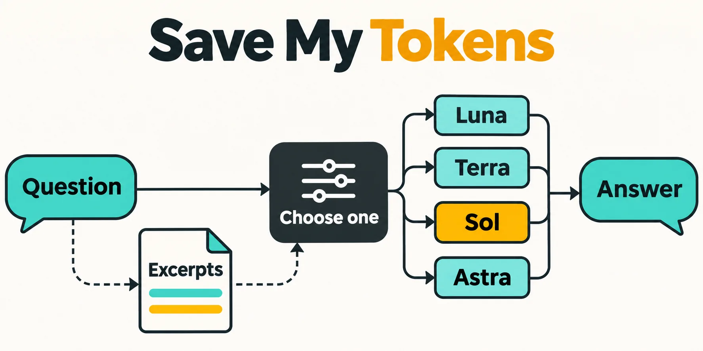
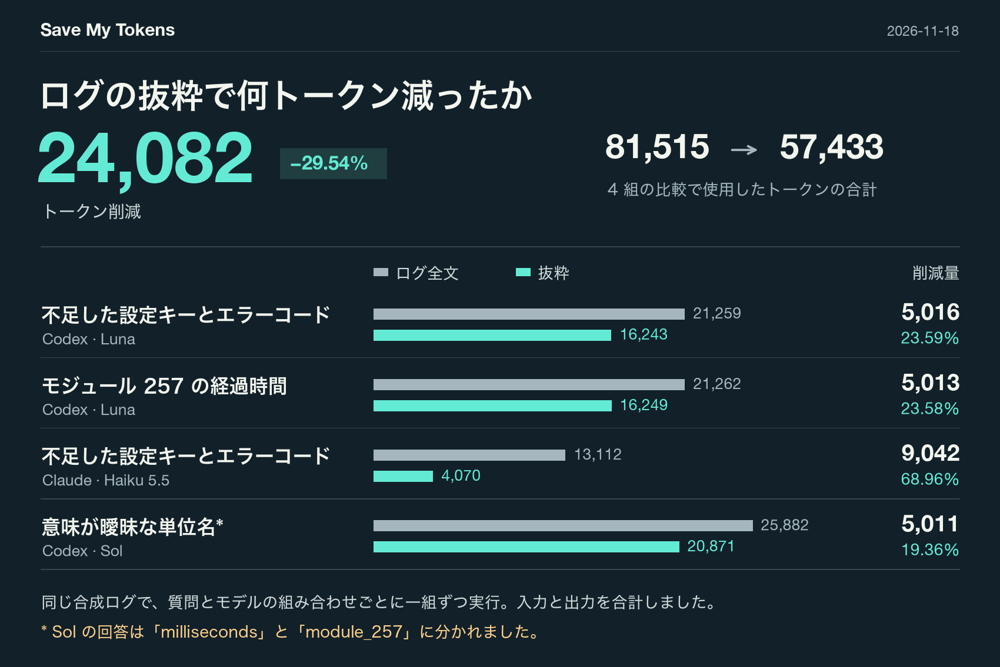

# Save My Tokens

[English](README.md) · [한국어](README.ko.md) · [简体中文](README.zh-CN.md) · [日本語](README.ja.md)

長いログから回答に必要な箇所を抜き出し、依頼ごとにモデルを選びます。分類は手元のルールで行うため、モデルを呼び出す必要はありません。



[4 組の比較で 24,082 トークンを削減した結果を見る](#実測結果)

## 仕組み

1. 手がかりとなる文字列をファイル全体から探し、元の位置と周辺の文章を取り出します。既定の上限は 4,096 バイトです。`--at BYTE` で周辺を確認できます。すべての件数が必要な場合は元ファイル全体を検索してください。
2. 抽出、範囲が狭い作業、通常の実装、深い推論の四段階に分け、利用するサービスのモデルを選びます。端末でログに `--ask` を付けると、質問と抜粋を Codex に送ります。
3. 図は Sol が答える例です。通常の処理は一回です。比較を明示した場合に、適用前後の回答をそれぞれ記録します。

## プラットフォーム別のインストール

リポジトリを取得し、そのディレクトリで次のコマンドを実行します。`/path/to/project` は既存プロジェクトのパス、`cursor` は表のインストール ID に置き換えてください。各スキルには必要な Python スクリプトが含まれます。プロジェクトを開き直して `save-my-tokens` を選びます。

```sh
git clone https://github.com/pappagallos/save-my-tokens.git
cd save-my-tokens
python3 install.py --platform cursor --project /path/to/project
```

Codex 専用プラグインはリポジトリ内で以下を実行し、新しい会話で選んでください。インストール後もリポジトリを残してください。

```sh
codex plugin marketplace add .
codex plugin add save-my-tokens@save-my-tokens-local
codex plugin list --marketplace save-my-tokens-local --json
```

Python 3.9 以上と Git が必要です。モデルを使う環境の CLI も導入してください。PATH の個人用ディレクトリにリンクすると、作業プロジェクトから起動できます。

```sh
mkdir -p "$HOME/.local/bin"
ln -s "$PWD/save-my-tokens" "$HOME/.local/bin/save-my-tokens"
```

| 環境 | インストール ID | プロジェクト内の場所 | 端末のモデル選択 |
|---|---|---|---|
| Codex CLI | `codex` | `.agents/skills/` | CLI のモデル一覧 · `codex` |
| Claude Code | `claude` | `.claude/skills/` | 提供元の別名 · `claude` |
| Cursor | `cursor` | `.cursor/skills/` | CLI のモデル一覧 · `agent` |
| Gemini CLI | `gemini` | `.gemini/skills/` | ACP のモデル一覧 · `gemini --acp` |
| Grok Build | `grok` | `.grok/skills/` | CLI のモデル一覧 · `grok` |
| GitHub Copilot | `copilot` | `.github/skills/` | ACP のモデル一覧 · `copilot --acp` |
| Devin | `devin` | `.devin/skills/` | ACP のモデル一覧 · `devin acp` |
| OpenCode | `opencode` | `.opencode/skills/` | ACP のモデル一覧 · `opencode acp` |
| Google Antigravity | `antigravity` | `.agents/skills/` | ACP のモデル一覧 · `agy_acp_server.par` |
| Kiro | `kiro` | `.kiro/skills/` | ACP のモデル一覧 · `kiro-cli acp` |
| TRAE | `trae` | `.trae/skills/` | ACP のモデル一覧 · `traecli acp serve` |
| TRAE China | `trae-cn` | `.trae/skills/` | ACP のモデル一覧 · `traecli acp serve` |
| Qoder | `qoder` | `.qoder/skills/` | ACP のモデル一覧 · `qodercli --acp` |
| Mistral Vibe | `vibe` | `.vibe/skills/` | ACP のモデル一覧 · `vibe-acp` |
| Pi | `pi` | `.pi/skills/` | ACP のモデル一覧 · `pi-acp` |
| Hermes Agent | `hermes` | `.hermes/skills/` | ACP のモデル一覧 · `hermes acp` |
| DeepSeek Harness | `deepseek` | `.dsh/skills/` | ACP のモデル一覧 · `dsh --profile acp` |
| Oh My Pi | `omp` | `.omp/skills/` | ACP のモデル一覧 · `omp acp` |
| Replit Agent | `replit` | `.agents/skills/` | 外部エンジンを指定 |
| Rovo Dev | `rovodev` | `.rovodev/skills/` | 外部エンジンを指定 |
| Veto | `veto` | `.veto/skills/` | 外部エンジンを指定 |

ACP は端末とコーディング支援ツールをつなぐ通信規約です。利用可能なモデルを問い合わせ、質問を送る前にモデルを指定できます。表にあるプログラムを導入してログインしてください。エディタ内のスキルからも原文を抜粋できます。Hermes ではプロジェクト内で `hermes skills trust` を実行し、Trae は導入後に再起動してください。個人用スキルだけを読む Veto では `--project "$HOME"` を指定します。

Claude の連続対話には `claude-agent-acp` も必要です。ACP はモデルの選択肢を返す環境で動作します。各ツールの権限設定が適用されます。

上表は共通スキルとターミナルでの動作です。通常のチャットの検証範囲は下表を参照してください。

## 通常の Codex チャットで作業を分担する

同じマーケットプレイスから次のプラグインを追加し、Codex の **プラグイン → インストール済み → Save My Tokens · Auto Workers** で有効にします。

```sh
codex plugin add save-my-tokens-auto@save-my-tokens-local
```

個人用の `~/.codex/AGENTS.md` に次の一文を追加し、新しいチャットを開いてください。

> `save-my-tokens-auto:assign-worker` が使える場合、毎回の依頼で独立した作業をサブエージェントに自動で割り当ててください。メインモデルを維持し、プロジェクトの規則に従ってください。

簡単な質問にはメインが答えます。分担する際は、抜粋には Luna、範囲を絞った調査には Terra、関連ファイルの変更には Sol、難しい設計の検討には Astra を優先します。現在のチャットで子に指定できるモデルから選びます。無効にすると新しいチャットからこのスキルが消えます。Codex CLI 0.169.0 の通常のチャットで、独立した二つのコード調査を依頼しました。実行記録ではメインが Sol（`gpt-6.2-sol`）、使用量の計算を調べた子が Terra（`gpt-6.1-terra`）でした。子の呼び出しにもトークンを使います。下の比較値はログ抜粋の実測結果です。 [Codex](https://learn.chatgpt.com/docs/agent-configuration/subagents)

## 他のアプリの通常のチャットで自動的に分担する

取得したリポジトリでコマンドを実行し、新しいチャットを開きます。`--auto-workers` を付けると下表の方法で分担を設定します。従来のコマンドは共通スキルのみを追加します。

```sh
python3 install.py --platform claude --project /path/to/project --auto-workers
```

モデル ID が必要な場合、インストーラーはログイン済みの CLI に一覧を問い合わせます。下の LIGHT、STANDARD、DEEP をそのアプリの子エージェントで選べる ID に置き換えても構いません。会話では作業ごとに役割を選びます。モデルの追加時は再実行して固定 ID を更新してください。ユーザーが編集したファイルは保持されます。利用可能なモデルが一つなら複数の役割で共有できます。

```sh
python3 install.py --platform cursor --project /path/to/project --auto-workers --worker-models LIGHT STANDARD DEEP
```

Grok と Devin は個人の設定ファイルを読みます。更新するには `--user-settings` を付けます。Grok では三つの子のモデルを設定し、Devin では既定モデルを Adaptive に切り替えます。Replit はアプリの設定画面で選択します。

```sh
python3 install.py --platform grok --project /path/to/project --auto-workers --user-settings
python3 install.py --platform devin --project /path/to/project --auto-workers --user-settings
```

| プラットフォーム | アプリ内の設定 | 今回の検証範囲 |
|---|---|---|
| Codex | 上記の Auto Workers と個人設定を有効にします。 [Codex](https://learn.chatgpt.com/docs/agent-configuration/subagents) | メイン・子の実行記録 |
| Claude Code | 根拠調査は Haiku、変更は Sonnet、難しい調査は Opus に任せるようプロジェクトルールを追加します。 [公式資料](https://code.claude.com/docs/en/sub-agents) | Haiku・Opus 自動呼び出し完了 |
| Cursor | 三つの役割と常時適用ルールを追加します。プランやチームの設定で実行モデルが変わる場合があります。 [公式資料](https://cursor.com/docs/subagents) | 2026.11.17 はログインが必要で役割の読み込みは未確認 |
| Gemini CLI | 三つの役割と GEMINI.md の指示を追加します。選択可能なモデル ID を使います。 [公式資料](https://geminicli.com/docs/core/subagents/) | 0.68.0 でローカル模擬サーバーへの子呼び出しを確認 |
| GitHub Copilot CLI | 自動選択する三つの役割に必須モデルを割り当てます。検証時はメインを固定してください。 [公式資料](https://docs.github.com/en/copilot/how-tos/copilot-cli/customize-copilot/create-custom-agents-for-cli) | 1.0.113 で三つを認識。アカウントポリシーで推論を停止 |
| OpenCode | 三つの役割を追加します。provider/model に任意で #variant を付けられます。 [公式資料](https://opencode.ai/docs/agents/) | 1.19.6・2.3.2 で認識、2.3.2 で模擬サーバーへの子呼び出し |
| Grok Build | プロジェクトルールで explore、general-purpose、plan に分担します。--user-settings で個人のモデル設定も更新します。 [公式資料](https://docs.x.ai/build/settings/reference) | 1.0.89 で承認後に子の作業が二件完了。このアカウントは grok-4.7 のみ |
| Devin CLI | /model adaptive か --user-settings で個人の既定値を設定します。企業ポリシーが適用されます。 [公式資料](https://docs.devin.ai/cli/adaptive) | 3000.14.30821 で個人設定を読み込み。モデル一覧にはログインが必要 |
| Replit Agent | Free Mode は自動選択です。対象プランでは Agent 設定の Power/Max で Auto を選びます。 [公式資料](https://docs.replit.com/features/agent/agent-modes) | 設定手順を確認 |
| Antigravity | flash・inherit・pro の役割を追加します。/agents で確認できます。 [公式資料](https://antigravity.google/docs/subagents) | 一時プロジェクトにインストール |
| Kiro | IDE 1.x または CLI V3 で /model の ID を指定します。 [公式資料](https://kiro.dev/docs/custom-agents/configuration-reference/) | 一時プロジェクトにインストール |
| Qoder | 信頼済みプロジェクトで /agents reload を実行します。既定は lite・efficient・performance です。 [公式資料](https://docs.qoder.com/cli/subagent) | 1.1.91 を起動。隔離環境で役割一覧の応答は未確認 |
| Mistral Vibe | 登録済みのモデル別名を指定して信頼済みプロジェクトを開いてください。 [公式資料](https://docs.mistral.ai/vibe/code/cli/agents) | 3.1.2 で三つの別名を認識。代替モデルの通知に注意 |
| TRAE China | 組み込み Agent とモデル ID を使います。必要に応じて Beta の Subagents Directory を有効にします。 [公式資料](https://docs.trae.cn/ide_subagents) | 一時プロジェクトにインストール |
| Rovo Dev | 三つの役割を追加し、/subagents でそれぞれのモデルを選びます。 [公式資料](https://support.atlassian.com/rovo/docs/use-subagents-in-rovo-dev-cli/) | 一時プロジェクトにインストール |
| Oh My Pi | 三つの task 役を追加し、Oh My Pi が認識するモデルを指定します。 [公式資料](https://github.com/can1357/oh-my-pi/blob/main/docs/task-agent-discovery.md) | 18.22.2 の /agents に三つの役割を表示 |
| Pi | pi-subagents 拡張とプロジェクトの信頼が必要です。拡張と役割を追加し /subagents-doctor を実行します。 [公式資料](https://github.com/nicobailon/pi-subagents/blob/main/docs/agents.md) | 一時プロジェクトにインストール |
| Hermes | advanced-delegation を有効にし、hermes delegation config で経路を作り /delegation で model_map を選びます。 [公式資料](https://hermes-agent.nousresearch.com/docs/user-guide/features/delegation) | 設定手順を確認 |
| DeepSeek Harness | Plugins で子モデルの選択と提供元・モデルの組を許可し、新しいセッションを開きます。 [公式資料](https://github.com/deepseek-ai/deepseek-harness/blob/master/packages/subagent/tool-subagent/README.md) | 設定手順を確認 |
| TRAE Global | プロジェクトの .trae/agents に三つの役割を追加し、組み込み Agent とモデル ID を使います。 [TRAE](https://docs.trae.ai/ide/subagents) | 一時プロジェクトにインストール |
| Veto | veto doctor で連携を確認し、veto start で外部セッションを開始します。 [公式資料](https://github.com/oleg-koval/veto) | 設定手順を確認 |

**2026年11月18日の検証。** ログイン済みの新しいチャットで、Codex 0.169.0 と 0.170.0 はメインを Astra に保ち、調査一件を Terra に任せました。簡単な計算にはメインだけが応答しました。Claude Code 2.1.319 では Sonnet が Haiku と Opus に分担しました。対象は Save My Tokens 0.4.0 と Auto Workers 0.2.0 です。下のトークングラフはログ抜粋の実測値です。子モデルの呼び出しにも使用量が発生します。

ローカル模擬サーバーは所定の応答でアプリの委任経路とモデル ID を検証します。一時プロジェクトでは設定ファイルの生成を確認しています。実際の使用量と削減率は各アカウントで別途計測が必要です。Grok の個人設定には Python 3.11 以上または tomli が必要です。

下のコマンドでインストールの検査を再実行できます。実際のアプリでは新しいチャットで独立した調査を二件依頼し、子の実行記録で役割と実行モデルを確認してください。

```sh
python3 -m unittest discover -s experiments -p 'test_*.py'
```

## リクエストごとのモデル選択

`route` は選択を表示し、`task` は質問を実行します。`chat` は同じ会話を保ったまま、質問ごとに選び直します。終了は `/exit` です。切り替わるのはランチャーが開いた会話です。既存のエディタの会話は各アプリが管理します。外部エンジンと書かれた環境では、プロジェクトの端末から `--engine codex` のようにログイン済みのエンジンを指定してください。

```sh
save-my-tokens route --engine codex 'エラーコードを抽出して'
save-my-tokens task --engine claude 'パーサーを実装して'
save-my-tokens chat --engine codex
save-my-tokens build.log -q failure_code --ask 'エラーコードを抽出して'
```

依頼の種類に優先するモデル系列を決め、その系列で一覧にある最も大きいバージョン番号を選びます。優先順は本プロジェクトのルールです。一覧はアカウント、地域、CLI の版によって変わります。一つしかない場合は全段階でそのモデルを使います。Claude の単発実行は提供元が管理する Haiku・Sonnet・Opus の別名を使います。モデル一覧が空の場合は停止します。`--model ID` または `--tiers 軽量 集中 通常 高性能` で自分の選択を指定できます。「続けて」は直前の段階を引き継ぎます。 [Codex](https://learn.chatgpt.com/docs/non-interactive-mode) · [Claude Code](https://code.claude.com/docs/en/model-config) · [Cursor](https://cursor.com/docs/cli/reference/parameters) · [Grok Build](https://docs.x.ai/build/cli/reference) · [Gemini](https://geminicli.com/docs/cli/model/) · [ACP](https://agentclientprotocol.com/protocol/v1/session-config-options) · [ACP registry](https://github.com/agentclientprotocol/registry)

以下は優先するモデル系列です。複数の段階で同じモデルを使うことがあります。複数の提供元に対応するツールでは、そのアカウントに表示された候補から選びます。契約が対応していれば `--model fable` で Claude Fable を明示できます。別名の実際のバージョンと料金条件は提供元が決めます。

| 作業 | 単純な抽出 | 範囲が狭い作業 | 通常の実装 | 深い推論 |
| --- | --- | --- | --- | --- |
|  | 抽出・翻訳・短い要約 | スクリーンショットの確認や単一ファイルの修正 | 機能実装・デバッグ・リファクタリング | 競合、断続的なデータ消失、複数サービスにまたがる障害の原因調査 |
| Codex | Luna | Terra | Sol | Astra |
| Claude Code / Kiro | Haiku | Sonnet | Sonnet | Opus |
| Gemini / Antigravity | Flash-Lite | Flash | Flash | Pro |
| Cursor | Mini / Haiku | Composer / Terra | Sonnet / Sol | Opus / Astra |
| Grok Build | Non-reasoning / Fast | Build / Code | Build / Grok | Reasoning / Heavy / Grok |
| Copilot | Mini / Haiku | Terra / Flash | Sol / Sonnet | Astra / Opus |
| Devin | Haiku / Fast | SWE / Terra | Sonnet / Sol | Opus / Astra |
| Qoder | Efficient | Efficient | Performance / Fast | Ultimate |
| Mistral Vibe | Small / Mini | Devstral Small | Devstral / Medium | Large / Medium |
| DeepSeek Harness | Flash | Flash / Coder | Pro / Chat | Pro / Reasoner |
| TRAE / TRAE China | Flash / Mini | Coder / Seed | Sonnet / GLM / Qwen | Opus / Pro / Reasoner |
| OpenCode / Hermes / Pi / Oh My Pi | Luna / Haiku / Flash-Lite | Terra / Flash / Sonnet | Sol / Sonnet / Composer | Astra / Opus / Pro |

Replit と Rovo Dev はプロジェクトの端末で指定した外部 CLI を使います。Rovo 自体には `/models` メニューがあります。oleg-koval の Veto CLI で `task --host veto --engine codex` を使うと、選んだモデルを `veto start` に渡します。他の Veto 製品では端末から外部 CLI を直接選べます。 [Devin](https://docs.devin.ai/cli/models) · [Copilot](https://docs.github.com/en/copilot/reference/ai-models/supported-models) · [OpenCode](https://opencode.ai/docs/models/) · [Qoder](https://docs.qoder.com/cli/model) · [DeepSeek](https://api-docs.deepseek.com/quick_start/pricing/) · [Mistral](https://docs.mistral.ai/models) · [Rovo](https://support.atlassian.com/rovo/docs/switch-between-large-language-models-in-rovo-dev-cli/) · [Veto](https://github.com/oleg-koval/veto)

```sh
save-my-tokens models --engine codex
save-my-tokens models --engine gemini
save-my-tokens models --engine qoder
save-my-tokens route --host replit --engine claude 'fix a typo'
```

## 質問ごとの使用量比較

同じログと同じ質問で `compare` を実行すると、サービスを二回呼び出します。ファイルを渡すと、既定では同じモデルで抜粋の効果を比較します。ファイルを渡さない場合は通常モデルと自動選択モデルを比較します。基準は `--baseline-model` で変更できます。実際の使用量の比較は Codex と Claude Code に対応します。どの環境でも `measure` を使い、OpenAI の `o200k_base` 方式で本文のサイズを手元で推定できます。

```sh
python3 experiments/benchmark.py --write-log /tmp/smt-example.log
question='Extract the missing key and failure code. Return both values.'
./save-my-tokens compare "$question" --file /tmp/smt-example.log -q failure_code \
  --expect SNAPSHOT_CLOCK --expect E7429 --out results.jsonl
./save-my-tokens compare --engine claude "$question" --file /tmp/smt-example.log -q failure_code
uv run --with tiktoken==0.12.0 -- ./save-my-tokens measure "$question" --file /tmp/smt-example.log -q failure_code
```

質問、両方のモデル、入力・キャッシュ入力・出力・合計、時間、回答、期待する文字列の有無を記録します。キャッシュ入力は入力に含まれます。削減量は適用前の合計から適用後の合計を引いた値です。負の場合は使用量が増えています。`--out` を指定すると質問と回答をローカルファイルに追記します。

## 実測結果



| 質問 | モデル | 適用前 → 適用後（合計） | 削減率 | 回答 |
|---|---|---|---|---|
| 不足した設定キーとエラーコード | Luna | 21,259 → 16,243 | 23.59% | 両方正解 |
| モジュール 257 の経過時間 | Luna | 21,262 → 16,249 | 23.58% | 両方 `15` |
| 不足した設定キーとエラーコード | Haiku 5.5 | 13,112 → 4,070 | 68.96% | 両方正解 |
| 意味が曖昧な単位名の質問 | Sol | 25,882 → 20,871 | 19.36% | 回答が異なる |

各行は同じ合成ログで一組ずつ測定した結果です。曖昧な質問では `milliseconds` と `module_257` に回答が分かれました。特定の文字列を含むかだけでは、意図に合う回答かは判断できません。合計にはサービス側の指示も含まれます。契約上の利用枠、料金、平均削減率は測定していません。モデルの切り替えはキャッシュの再利用にも影響します。 [JSONL](experiments/observations.jsonl) · [v0.2.0 · 한국어](experiments/v0.2.ko.md)

## 研究と README の根拠

Nature の OpenScholar 研究は関連する段落の検索と出典の表示を評価しました。npj Digital Medicine の研究では長い文章内の根拠の位置を変えて比較しました。これを参考にファイル全体を検索し、原文の位置を残します。本ツールは文字列検索を使い、ログへの効果は独自に測定しています。 [Nature · OpenScholar](https://www.nature.com/articles/s41586-025-10072-4) · [npj Digital Medicine](https://www.nature.com/articles/s41746-025-01651-w) · [2025 JIF](https://www.nature.com/nature-portfolio/about-journals/journal-metrics)

Superpowers は作業の流れと環境別の導入方法を冒頭に置き、Context7 は同じ依頼に対する結果を比較しています。RTK は使用量の測定コマンドを用意し、Impeccable は利用例と対応環境を並べています。本書では回答の正しさと、結果が分かれた例も公開します。 [Superpowers](https://github.com/obra/superpowers) · [Context7](https://github.com/upstash/context7) · [RTK](https://github.com/rtk-ai/rtk) · [Impeccable](https://github.com/pbakaus/impeccable/tree/d41d9860b0094dcb68030657da63461212835aaa)

今回スコアを確認した Codex の投稿では、重複した読み込みと長い出力を減らした事例が +298、軽い作業を Luna に振り分けた事例が +21 でした。11 月には Claude Code で作業別の費用と正確さを比較した続報も公開されています。得票数は検索時点の表示で、結果は投稿者の作業条件によるものです。 [r/codex · +298](https://www.reddit.com/r/codex/comments/1tyxkzj/how_i_cut_codex_token_use_from_138mday_to_20mday/) · [r/codex · +21](https://www.reddit.com/r/codex/comments/1vdbi4s/luna_just_got_80_cheaper_so_i_rebuilt_my_codex/) · [r/ClaudeCode](https://www.reddit.com/r/ClaudeCode/comments/1xxyc5a/does_delegating_to_cheaper_models_actually_save/)
