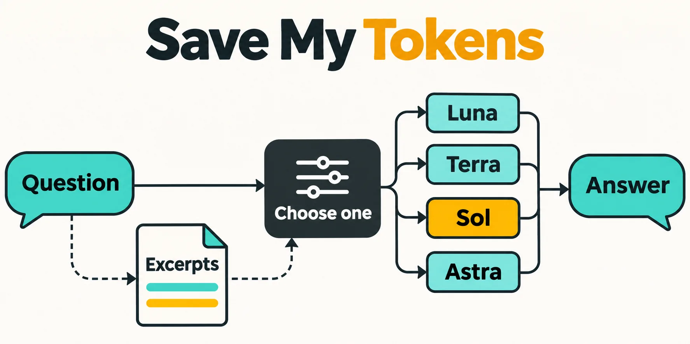
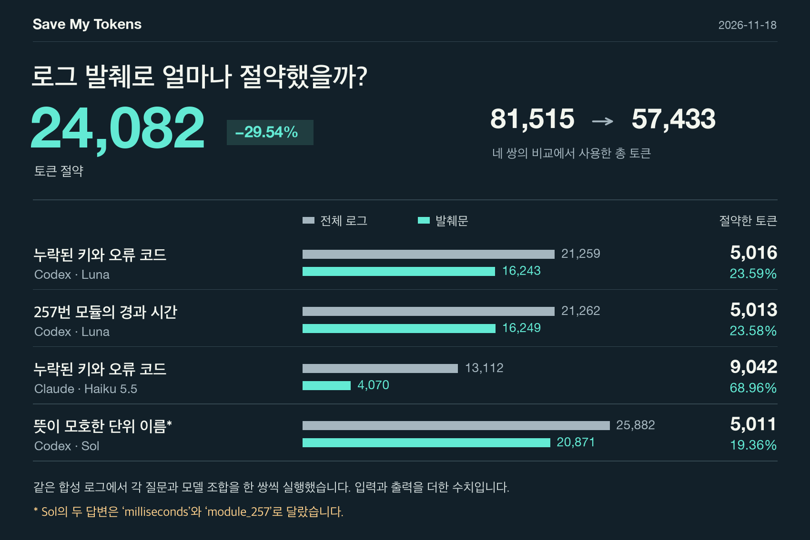

# Save My Tokens

[English](README.md) · [한국어](README.ko.md) · [简体中文](README.zh-CN.md) · [日本語](README.ja.md)

긴 로그에서 질문에 필요한 줄을 골라 보내고, 요청마다 작업에 맞는 모델을 선택합니다. 어떤 모델을 쓸지는 컴퓨터에서 규칙으로 판단하므로 분류 자체에 모델 호출이 들지 않습니다.



[네 쌍의 비교에서 24,082토큰을 절약한 결과 보기](#실제-측정-결과)

## 작동 원리

1. 파일에서 단서가 담긴 원문과 앞뒤 내용을 찾습니다. 기본 한도는 4,096바이트입니다. 원문 위치도 함께 남겨서 `--at BYTE`로 더 읽을 수 있습니다. 전체 발생 횟수는 파일 전체를 검색하세요.
2. 요청 문구를 보고 단순 추출·범위가 좁은 작업·일반 구현·깊은 추론 중 하나를 고르고, 선택한 플랫폼이 제공하는 모델에 연결합니다. 터미널에서 로그와 `--ask`를 함께 주면 질문과 발췌문을 Codex에 보냅니다.
3. 그림에서는 Sol 하나가 답합니다. 평소에는 한 번만 실행하고, 직접 비교를 요청할 때만 적용 전후의 답을 각각 얻습니다.

## 플랫폼별 설치

저장소를 내려받고 그 폴더에서 아래 명령을 실행하세요. `/path/to/project`에는 작업할 프로젝트 경로를, `cursor` 자리에는 표의 설치 ID를 넣으세요. 각 설치본에는 원문 발췌와 모델 선택에 필요한 파이썬 파일이 들어 있습니다. 프로젝트를 다시 열고 `save-my-tokens` 스킬을 선택하세요.

```sh
git clone https://github.com/pappagallos/save-my-tokens.git
cd save-my-tokens
python3 install.py --platform cursor --project /path/to/project
```

Codex 전용 플러그인은 내려받은 저장소에서 아래 명령으로 설치합니다. 새 Codex 대화에서 선택할 수 있습니다. 설치 후에도 저장소 폴더를 유지하세요.

```sh
codex plugin marketplace add .
codex plugin add save-my-tokens@save-my-tokens-local
codex plugin list --marketplace save-my-tokens-local --json
```

Python 3.9 이상과 Git이 필요합니다. 모델을 실행하려면 사용할 플랫폼의 CLI도 설치하세요. 작업 프로젝트에서 실행하려면 아래처럼 개인 명령 폴더에 연결할 수 있습니다.

```sh
mkdir -p "$HOME/.local/bin"
ln -s "$PWD/save-my-tokens" "$HOME/.local/bin/save-my-tokens"
```

| 플랫폼 | 설치 ID | 프로젝트 폴더 | 터미널 모델 선택 |
|---|---|---|---|
| Codex CLI | `codex` | `.agents/skills/` | CLI 모델 목록 · `codex` |
| Claude Code | `claude` | `.claude/skills/` | 공급사 별칭 · `claude` |
| Cursor | `cursor` | `.cursor/skills/` | CLI 모델 목록 · `agent` |
| Gemini CLI | `gemini` | `.gemini/skills/` | ACP 모델 목록 · `gemini --acp` |
| Grok Build | `grok` | `.grok/skills/` | CLI 모델 목록 · `grok` |
| GitHub Copilot | `copilot` | `.github/skills/` | ACP 모델 목록 · `copilot --acp` |
| Devin | `devin` | `.devin/skills/` | ACP 모델 목록 · `devin acp` |
| OpenCode | `opencode` | `.opencode/skills/` | ACP 모델 목록 · `opencode acp` |
| Google Antigravity | `antigravity` | `.agents/skills/` | ACP 모델 목록 · `agy_acp_server.par` |
| Kiro | `kiro` | `.kiro/skills/` | ACP 모델 목록 · `kiro-cli acp` |
| TRAE | `trae` | `.trae/skills/` | ACP 모델 목록 · `traecli acp serve` |
| TRAE China | `trae-cn` | `.trae/skills/` | ACP 모델 목록 · `traecli acp serve` |
| Qoder | `qoder` | `.qoder/skills/` | ACP 모델 목록 · `qodercli --acp` |
| Mistral Vibe | `vibe` | `.vibe/skills/` | ACP 모델 목록 · `vibe-acp` |
| Pi | `pi` | `.pi/skills/` | ACP 모델 목록 · `pi-acp` |
| Hermes Agent | `hermes` | `.hermes/skills/` | ACP 모델 목록 · `hermes acp` |
| DeepSeek Harness | `deepseek` | `.dsh/skills/` | ACP 모델 목록 · `dsh --profile acp` |
| Oh My Pi | `omp` | `.omp/skills/` | ACP 모델 목록 · `omp acp` |
| Replit Agent | `replit` | `.agents/skills/` | 외부 엔진 직접 선택 |
| Rovo Dev | `rovodev` | `.rovodev/skills/` | 외부 엔진 직접 선택 |
| Veto | `veto` | `.veto/skills/` | 외부 엔진 직접 선택 |

ACP는 터미널이 코딩 도구에 사용 가능한 모델을 묻고 질문을 보내기 전에 모델을 바꾸는 통신 방식입니다. 아래에 표시된 실행 파일을 설치하고 해당 계정에 로그인하세요. 편집기 안에서는 설치한 스킬로 로그를 바로 발췌할 수도 있습니다. Hermes는 프로젝트에서 `hermes skills trust`를 실행하고, Trae는 설치 후 다시 여세요. 개인 스킬만 읽는 Veto에서는 `--project "$HOME"`으로 설치합니다.

Claude의 연속 대화에는 `claude-agent-acp` 실행 파일이 추가로 필요합니다. ACP 방식은 해당 버전이 모델 목록을 제공해야 동작하며, 도구 실행 권한은 그대로 적용됩니다.

위 표는 공통 스킬과 터미널 실행기를 설명합니다. 일반 대화의 자동 배정 검증 범위는 아래 표에서 확인할 수 있습니다.

## 일반 Codex 대화에서 작업 나누기

같은 마켓플레이스에서 아래 플러그인을 추가하고 Codex의 **플러그인 → 설치됨 → Save My Tokens · Auto Workers**에서 켜세요.

```sh
codex plugin add save-my-tokens-auto@save-my-tokens-local
```

개인 설정 파일 `~/.codex/AGENTS.md`에 다음 한 줄을 추가하고 새 대화를 여세요.

> `save-my-tokens-auto:assign-worker` 스킬이 있으면 매 요청에서 독립적인 작업을 서브 에이전트에 자동 배정해 주세요. 메인 모델을 유지하고 프로젝트 규칙을 따라 주세요.

간단한 질문은 메인이 답합니다. 분리할 만한 작업이 있으면 단순 발췌는 Luna, 좁은 범위의 조사는 Terra, 관련 파일의 수정은 Sol, 복잡한 설계 검토는 Astra를 우선합니다. 현재 대화에서 보조 작업에 쓸 수 있는 모델 중에서 고릅니다. 플러그인을 끄면 새 대화에서 이 스킬이 사라집니다. Codex CLI 0.169.0에서 일반 대화로 두 코드 경로의 조사를 요청했습니다. 실행 기록에서 메인은 Sol(`gpt-6.2-sol`), 토큰 계산을 조사한 보조 모델은 Terra(`gpt-6.1-terra`)로 확인했습니다. 작업을 나누면 별도 호출에 토큰이 듭니다. 아래 전후 비교 수치는 로그 발췌 실험 결과입니다. [Codex](https://learn.chatgpt.com/docs/agent-configuration/subagents)

## 다른 앱의 일반 대화에서 자동 배정하기

내려받은 저장소에서 아래 명령을 실행하고 새 대화를 여세요. `--auto-workers`를 붙이면 표에 나온 방식으로 작업 배정을 설정합니다. 기존 설치 명령만 실행하면 공통 스킬만 설치합니다.

```sh
python3 install.py --platform claude --project /path/to/project --auto-workers
```

모델 ID가 필요한 앱은 설치할 때 로그인된 CLI에 모델 목록을 요청합니다. 직접 지정하려면 아래 LIGHT, STANDARD, DEEP 자리에 그 앱에서 보조 작업용으로 선택할 수 있는 모델 ID를 넣으세요. 대화 중에는 작업에 맞는 역할을 고릅니다. 새 모델이 출시되면 설치 명령을 다시 실행해 역할별 모델을 갱신하세요. 직접 편집한 파일은 보존합니다. 사용 가능한 모델이 하나면 여러 역할이 같은 모델을 쓸 수 있습니다.

```sh
python3 install.py --platform cursor --project /path/to/project --auto-workers --worker-models LIGHT STANDARD DEEP
```

Grok과 Devin은 모델 설정을 개인 파일에서 읽습니다. 이 파일까지 바꾸려면 `--user-settings`를 붙이세요. Grok은 세 보조 역할의 모델을 지정하고, Devin은 기본 모델을 Adaptive로 바꿉니다. Replit은 앱의 설정 메뉴에서 선택합니다.

```sh
python3 install.py --platform grok --project /path/to/project --auto-workers --user-settings
python3 install.py --platform devin --project /path/to/project --auto-workers --user-settings
```

| 플랫폼 | 앱에서 적용하는 방법 | 이번에 확인한 범위 |
|---|---|---|
| Codex | 위의 Auto Workers와 개인 지침을 켜세요. [Codex](https://learn.chatgpt.com/docs/agent-configuration/subagents) | 메인·보조 모델 실행 기록 |
| Claude Code | 근거 찾기는 Haiku, 수정은 Sonnet, 복잡한 조사는 Opus에 맡깁니다. 프로젝트 규칙이 배정을 요청합니다. [공식 문서](https://code.claude.com/docs/en/sub-agents) | 자동 Haiku·Opus 호출 완료 |
| Cursor | 역할 3개와 대화마다 읽는 규칙을 설치합니다. 요금제나 팀 정책에 따라 실제 모델이 달라질 수 있습니다. [공식 문서](https://cursor.com/docs/subagents) | 2026.11.17 실행 시 로그인이 필요해 역할 로드 미확인 |
| Gemini CLI | 역할 3개와 GEMINI.md 지침을 설치합니다. 현재 선택할 수 있는 모델 ID를 사용하세요. [공식 문서](https://geminicli.com/docs/core/subagents/) | 0.68.0에서 로컬 모의 서버로 보조 호출 확인 |
| GitHub Copilot CLI | 자동 선택할 수 있는 역할 3개에 필수 모델을 지정합니다. 역할별 모델을 검증할 때 메인은 특정 모델로 설정하세요. [공식 문서](https://docs.github.com/en/copilot/how-tos/copilot-cli/customize-copilot/create-custom-agents-for-cli) | 1.0.113이 역할 3개를 인식했고 계정 정책으로 응답 실행이 차단됨 |
| OpenCode | 역할 3개를 설치합니다. provider/model 형식의 ID와 선택 사항인 #variant를 지원합니다. [공식 문서](https://opencode.ai/docs/agents/) | 1.19.6·2.3.2에서 역할 로드, 2.3.2에서 모의 서버로 보조 호출 |
| Grok Build | 프로젝트 규칙이 explore·general-purpose·plan에 배정합니다. --user-settings를 붙이면 개인 설정에 모델까지 저장합니다. [공식 문서](https://docs.x.ai/build/settings/reference) | 1.0.89에서 승인 후 보조 작업 2개 완료. 이 계정에 제공된 모델은 grok-4.7 하나 |
| Devin CLI | /model adaptive를 실행하거나 --user-settings로 개인 기본값을 지정합니다. 기업 계정 정책이 적용됩니다. [공식 문서](https://docs.devin.ai/cli/adaptive) | 3000.14.30821이 개인 설정을 읽음. 모델 목록 조회에 로그인 필요 |
| Replit Agent | Free Mode는 자동으로 선택합니다. 해당 요금제에서는 Agent 설정의 Power/Max에서 Auto를 선택하세요. [공식 문서](https://docs.replit.com/features/agent/agent-modes) | 설정 안내 확인 |
| Antigravity | flash·inherit·pro 역할을 설치합니다. /agents에서 확인하세요. [공식 문서](https://antigravity.google/docs/subagents) | 임시 프로젝트 설치 |
| Kiro | IDE 1.x 또는 CLI V3에서 /model의 모델 ID를 쓰세요. [공식 문서](https://kiro.dev/docs/custom-agents/configuration-reference/) | 임시 프로젝트 설치 |
| Qoder | 신뢰하는 프로젝트에서 /agents reload를 실행하세요. 기본 역할은 lite·efficient·performance입니다. [공식 문서](https://docs.qoder.com/cli/subagent) | 1.1.91 실행. 격리 환경에서 역할 목록 응답 미확인 |
| Mistral Vibe | Vibe에 등록된 모델 별칭을 지정하고 신뢰하는 프로젝트를 여세요. [공식 문서](https://docs.mistral.ai/vibe/code/cli/agents) | 3.1.2에서 설정된 별칭 3개 로드. 대체 모델 안내 확인 필요 |
| TRAE China | 내장 Agent와 내장 모델 ID를 사용하세요. 필요하면 Beta에서 Subagents Directory를 켜세요. [공식 문서](https://docs.trae.cn/ide_subagents) | 임시 프로젝트 설치 |
| Rovo Dev | 역할 3개를 설치한 뒤 /subagents 메뉴에서 각각의 모델을 선택하세요. [공식 문서](https://support.atlassian.com/rovo/docs/use-subagents-in-rovo-dev-cli/) | 임시 프로젝트 설치 |
| Oh My Pi | 역할 3개를 설치합니다. Oh My Pi의 작업 에이전트에서 쓸 수 있는 모델을 지정하세요. [공식 문서](https://github.com/can1357/oh-my-pi/blob/main/docs/task-agent-discovery.md) | 18.22.2의 /agents에서 역할 3개 인식 |
| Pi | Pi의 pi-subagents 확장과 프로젝트 신뢰가 필요합니다. 확장과 역할을 설치한 뒤 /subagents-doctor를 실행하세요. [공식 문서](https://github.com/nicobailon/pi-subagents/blob/main/docs/agents.md) | 임시 프로젝트 설치 |
| Hermes | advanced-delegation을 켜고 hermes delegation config로 경로를 지정한 뒤 /delegation에서 model_map을 선택하세요. [공식 문서](https://hermes-agent.nousresearch.com/docs/user-guide/features/delegation) | 설정 안내 확인 |
| DeepSeek Harness | Plugins에서 보조 모델 선택을 켜고 허용할 제공사·모델 쌍을 지정한 뒤 새 대화를 여세요. [공식 문서](https://github.com/deepseek-ai/deepseek-harness/blob/master/packages/subagent/tool-subagent/README.md) | 설정 안내 확인 |
| TRAE Global | 프로젝트의 .trae/agents에 역할 3개를 설치합니다. 내장 Agent와 내장 모델 ID를 쓰세요. [TRAE](https://docs.trae.ai/ide/subagents) | 임시 프로젝트 설치 |
| Veto | veto doctor로 연결을 확인하고 veto start로 새 외부 세션을 실행합니다. [공식 문서](https://github.com/oleg-koval/veto) | 설정 안내 확인 |

**2026년 11월 18일 검증.** 로그인된 새 대화에서 Codex 0.169.0과 0.170.0은 메인을 Astra로 유지하고 조사 한 건을 Terra에 맡겼습니다. 간단한 계산에서는 메인만 실행됐습니다. Claude Code 2.1.319에서는 메인 Sonnet이 Haiku와 Opus에 각각 맡겼습니다. 검증한 Codex 패키지는 Save My Tokens 0.4.0과 Auto Workers 0.2.0입니다. 아래 토큰 그래프는 로그 발췌 실험 결과입니다. 보조 모델을 호출하면 그 모델의 사용량도 발생합니다.

로컬 모의 서버 검증은 정해 둔 응답으로 앱의 실제 위임 경로와 모델 ID를 확인한 것입니다. 임시 프로젝트 설치는 생성된 설정 파일을 확인한 단계입니다. 각 계정의 실제 사용량과 절약률은 별도 측정이 필요합니다. Grok 개인 설정에는 Python 3.11 이상 또는 tomli 패키지가 필요합니다.

아래 명령으로 설치 검사를 다시 실행할 수 있습니다. 실제 앱을 확인하려면 새 대화에서 서로 독립적인 조사 두 건을 요청한 다음, 보조 작업의 실행 기록에서 역할과 실제 모델을 확인하세요.

```sh
python3 -m unittest discover -s experiments -p 'test_*.py'
```

## 요청마다 모델 고르기

`route`는 모델 선택 결과를 보여줍니다. `task`는 질문을 실행합니다. `chat`은 같은 대화를 이어 가면서 매번 모델을 다시 고릅니다. 끝내려면 `/exit`를 입력하세요. 모델이 바뀌는 곳은 이 명령이 연 대화입니다. 이미 열려 있는 앱 대화의 모델은 앱이 관리합니다. 표에 ‘외부 엔진 직접 선택’이라고 표시된 플랫폼에서는 프로젝트 터미널에서 `--engine codex`처럼 로그인한 엔진을 명시하세요.

```sh
save-my-tokens route --engine codex '오류 코드를 추출해 줘'
save-my-tokens task --engine claude '파서를 구현해 줘'
save-my-tokens chat --engine codex
save-my-tokens build.log -q failure_code --ask '오류 코드를 추출해 줘'
```

각 단계에서 우선순위가 높은 모델 계열을 찾아 그 안에서 목록에 나온 가장 높은 버전을 고릅니다. 작업과 계열을 연결하는 규칙은 이 프로젝트에서 정했습니다. 목록은 계정·지역·CLI 버전에 따라 다릅니다. 제공 모델이 하나면 네 단계 모두 같은 모델을 씁니다. Claude 단건 실행은 공급사가 연결하는 Haiku·Sonnet·Opus 별칭을 씁니다. 목록이 비면 중단합니다. `--model ID`로 직접 지정하거나 `--tiers 경량 집중 일반 심층`으로 기준을 바꿀 수 있습니다. ‘계속해’는 직전 단계를 유지합니다. [Codex](https://learn.chatgpt.com/docs/non-interactive-mode) · [Claude Code](https://code.claude.com/docs/en/model-config) · [Cursor](https://cursor.com/docs/cli/reference/parameters) · [Grok Build](https://docs.x.ai/build/cli/reference) · [Gemini](https://geminicli.com/docs/cli/model/) · [ACP](https://agentclientprotocol.com/protocol/v1/session-config-options) · [ACP registry](https://github.com/agentclientprotocol/registry)

아래는 이 플러그인이 먼저 찾는 모델 계열입니다. 두 단계가 한 모델을 공유할 수 있습니다. 여러 회사의 모델을 연결하는 플랫폼은 그 계정의 목록에서 고릅니다. Claude Fable은 계정이 허용할 때 `--model fable`로 지정할 수 있습니다. 별칭은 공급사가 실제 버전에 연결하며 요금 조건도 공급사를 따릅니다.

| 작업 | 단순 추출 | 범위가 좁은 작업 | 일반 구현 | 깊은 추론 |
| --- | --- | --- | --- | --- |
|  | 문자열 추출·번역·짧은 요약 | 화면 캡처 확인, 한 파일이나 함수 안의 수정 | 기능 구현·일반 디버깅·리팩터링 | 간헐적 데이터 유실, 동시성 문제, 여러 서비스에 걸친 원인 분석 |
| Codex | Luna | Terra | Sol | Astra |
| Claude Code / Kiro | Haiku | Sonnet | Sonnet | Opus |
| Gemini / Antigravity | Flash-Lite | Flash | Flash | Pro |
| Cursor | Mini / Haiku | Composer / Terra | Sonnet / Sol | Opus / Astra |
| Grok Build | Non-reasoning / Fast | Build / Code | Build / Grok | Reasoning / Heavy / Grok |
| Copilot | Mini / Haiku | Terra / Flash | Sol / Sonnet | Astra / Opus |
| Devin | Haiku / Fast | SWE / Terra | Sonnet / Sol | Opus / Astra |
| Qoder | Efficient | Efficient | Performance / Fast | Ultimate |
| Mistral Vibe | Small / Mini | Devstral Small | Devstral / Medium | Large / Medium |
| DeepSeek Harness | Flash | Flash / Coder | Pro / Chat | Pro / Reasoner |
| TRAE / TRAE China | Flash / Mini | Coder / Seed | Sonnet / GLM / Qwen | Opus / Pro / Reasoner |
| OpenCode / Hermes / Pi / Oh My Pi | Luna / Haiku / Flash-Lite | Terra / Flash / Sonnet | Sol / Sonnet / Composer | Astra / Opus / Pro |

Replit과 Rovo Dev는 프로젝트 터미널에서 명시한 외부 CLI를 씁니다. Rovo 자체 대화는 `/models` 메뉴로 변경할 수 있습니다. oleg-koval의 Veto CLI에서 `task --host veto --engine codex`는 선택한 모델로 `veto start`를 실행합니다. 다른 Veto 제품은 프로젝트 터미널에서 외부 CLI를 직접 선택할 수 있습니다. [Devin](https://docs.devin.ai/cli/models) · [Copilot](https://docs.github.com/en/copilot/reference/ai-models/supported-models) · [OpenCode](https://opencode.ai/docs/models/) · [Qoder](https://docs.qoder.com/cli/model) · [DeepSeek](https://api-docs.deepseek.com/quick_start/pricing/) · [Mistral](https://docs.mistral.ai/models) · [Rovo](https://support.atlassian.com/rovo/docs/switch-between-large-language-models-in-rovo-dev-cli/) · [Veto](https://github.com/oleg-koval/veto)

```sh
save-my-tokens models --engine codex
save-my-tokens models --engine gemini
save-my-tokens models --engine qoder
save-my-tokens route --host replit --engine claude 'fix a typo'
```

## 질문 하나의 적용 전후 비교

같은 로그와 같은 질문을 준비합니다. `compare`는 계정에서 두 번 실행합니다. 파일을 주면 기본으로 같은 모델을 써서 발췌 효과만 비교합니다. 파일 없이 실행하면 일반 모델로 답한 결과와 자동 선택한 모델로 답한 결과를 비교합니다. 첫 모델은 `--baseline-model`로 바꿀 수 있습니다. 실제 사용량 비교는 Codex와 Claude Code에서 지원합니다. 다른 플랫폼에서도 `measure`로 원문과 발췌문의 크기를 기기에서 비교할 수 있습니다. 이 값은 OpenAI의 `o200k_base` 방식으로 센 추정치입니다.

```sh
python3 experiments/benchmark.py --write-log /tmp/smt-example.log
question='Extract the missing key and failure code. Return both values.'
./save-my-tokens compare "$question" --file /tmp/smt-example.log -q failure_code \
  --expect SNAPSHOT_CLOCK --expect E7429 --out results.jsonl
./save-my-tokens compare --engine claude "$question" --file /tmp/smt-example.log -q failure_code
uv run --with tiktoken==0.12.0 -- ./save-my-tokens measure "$question" --file /tmp/smt-example.log -q failure_code
```

질문마다 양쪽 모델, 입력·캐시 입력·출력·합계, 소요 시간, 두 답변, 기대 문자열 포함 여부를 기록합니다. 캐시 입력은 입력에 이미 포함됩니다. 절감량은 적용 전 합계에서 적용 후 합계를 뺀 값이며 음수면 더 사용한 것입니다. `--out`을 지정하면 질문과 답변이 해당 파일에 누적됩니다.

## 실제 측정 결과



| 질문 | 모델 | 적용 전 → 후 (총 토큰) | 감소율 | 답변 확인 |
|---|---|---|---|---|
| 빠진 설정 키와 오류 코드 | Luna | 21,259 → 16,243 | 23.59% | 양쪽 정답 |
| 257번 모듈의 경과 시간 | Luna | 21,262 → 16,249 | 23.58% | 양쪽 모두 `15` |
| 빠진 설정 키와 오류 코드 | Haiku 5.5 | 13,112 → 4,070 | 68.96% | 양쪽 정답 |
| 뜻이 모호한 단위 이름 질문 | Sol | 25,882 → 20,871 | 19.36% | 두 답변이 다름 |

같은 합성 로그에서 질문·모델 조합당 한 쌍씩 실행했습니다. 단위 이름을 모호하게 물은 경우 `milliseconds`와 `module_257`로 답이 갈렸습니다. 문자열이 포함됐는지만 검사하면 의미가 맞았는지 판단하기 어렵습니다. 합계에는 서비스가 붙인 지침도 포함됩니다. 구독 한도·요금·평균 절감률은 이 실험으로 측정하지 않았습니다. 모델을 바꾸면 캐시 재사용량도 달라질 수 있습니다. [JSONL](experiments/observations.jsonl) · [v0.2.0 · 한국어](experiments/v0.2.ko.md)

## 연구와 README 설계 근거

Nature의 OpenScholar 연구는 질문에 맞는 문단을 찾아 출처를 남기는 방법을 평가했습니다. npj Digital Medicine 연구는 긴 입력에서 근거 위치를 바꿔 답의 정확성을 비교했습니다. 이를 참고해 파일 중간도 검색하고 원문 위치를 남겼습니다. 플러그인은 문자열 검색을 사용하며, 절감 효과는 로그 실험에서 따로 측정했습니다. [Nature · OpenScholar](https://www.nature.com/articles/s41586-025-10072-4) · [npj Digital Medicine](https://www.nature.com/articles/s41746-025-01651-w) · [2025 JIF](https://www.nature.com/nature-portfolio/about-journals/journal-metrics)

Superpowers는 작업 흐름과 플랫폼별 설치를 먼저 보여줍니다. Context7은 같은 요청의 결과를 비교하고, RTK는 절감량을 측정하는 명령을 제공합니다. Impeccable은 예시 그림과 지원 표를 붙여 놓았습니다. 이 README에는 정답 유지 여부와 답이 달라진 경우도 함께 실었습니다. [Superpowers](https://github.com/obra/superpowers) · [Context7](https://github.com/upstash/context7) · [RTK](https://github.com/rtk-ai/rtk) · [Impeccable](https://github.com/pbakaus/impeccable/tree/d41d9860b0094dcb68030657da63461212835aaa)

추천 점수가 보인 Codex 글 중에는 같은 파일을 거듭 읽거나 긴 명령 출력을 보내는 일을 줄였다는 경험담이 +298점이었습니다. 모델 자동 선택을 직접 다룬 글 중에는 가벼운 작업을 Luna에 맡긴 글이 +21점이었습니다. 11월에는 여러 작업에서 모델을 나눠 썼을 때 비용과 정확도를 비교한 Claude Code 후속 실험도 공개됐습니다. 점수는 검색 당시 표시값이며 각 실험은 작성자의 작업 환경에 한정됩니다. [r/codex · +298](https://www.reddit.com/r/codex/comments/1tyxkzj/how_i_cut_codex_token_use_from_138mday_to_20mday/) · [r/codex · +21](https://www.reddit.com/r/codex/comments/1vdbi4s/luna_just_got_80_cheaper_so_i_rebuilt_my_codex/) · [r/ClaudeCode](https://www.reddit.com/r/ClaudeCode/comments/1xxyc5a/does_delegating_to_cheaper_models_actually_save/)
