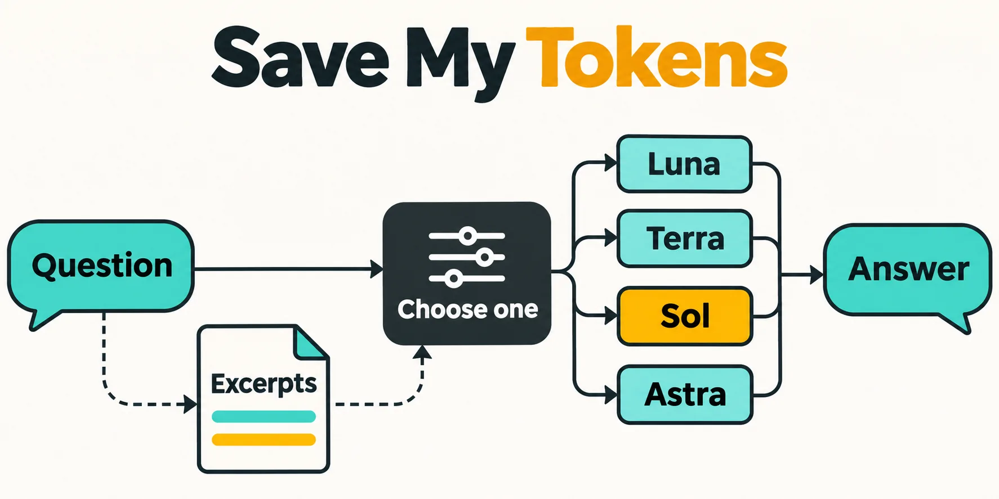
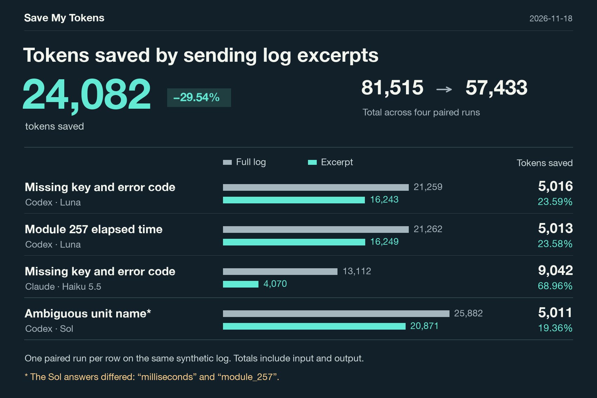

# Save My Tokens

[English](README.md) · [한국어](README.ko.md) · [简体中文](README.zh-CN.md) · [日本語](README.ja.md)

Send the useful lines of a long log to your coding agent and choose a model for each request. Selection runs on your computer without a model call.



[See how four paired runs saved 24,082 tokens](#what-we-measured)

## How it works

1. Search the original file for a literal clue. Keep short passages with their byte offsets, up to 4,096 bytes by default. Use `--at BYTE` for more context. Use a full-file search for counts or exhaustive lists.
2. Classify the request as extraction, a focused task, general implementation or deep reasoning using local rules. Choose a model available to the selected engine. For a log question, the terminal `--ask` path sends the question and the excerpts to Codex.
3. The diagram shows one example where Sol handles the request. A regular task runs once. An explicit comparison runs both versions and keeps the two answers.

## Install for your platform

Clone the repository once. Run the installer from that checkout. Replace `/path/to/project` with an existing project and `cursor` with the ID in the table. Each command installs a self-contained project skill with its Python scripts. Reopen the project and select `save-my-tokens`.

```sh
git clone https://github.com/pappagallos/save-my-tokens.git
cd save-my-tokens
python3 install.py --platform cursor --project /path/to/project
```

For the native Codex plugin, run these commands in the checkout and start a new Codex conversation. Keep the checkout in place.

```sh
codex plugin marketplace add .
codex plugin add save-my-tokens@save-my-tokens-local
codex plugin list --marketplace save-my-tokens-local --json
```

Setup requires Python 3.9+ and Git. For routed tasks, install the CLI you intend to use. Run the launcher from your project, or add a symlink to a directory on your PATH.

```sh
mkdir -p "$HOME/.local/bin"
ln -s "$PWD/save-my-tokens" "$HOME/.local/bin/save-my-tokens"
```

| Platform | Installer ID | Project directory | Terminal routing |
|---|---|---|---|
| Codex CLI | `codex` | `.agents/skills/` | live CLI list · `codex` |
| Claude Code | `claude` | `.claude/skills/` | provider alias · `claude` |
| Cursor | `cursor` | `.cursor/skills/` | live CLI list · `agent` |
| Gemini CLI | `gemini` | `.gemini/skills/` | ACP model list · `gemini --acp` |
| Grok Build | `grok` | `.grok/skills/` | live CLI list · `grok` |
| GitHub Copilot | `copilot` | `.github/skills/` | ACP model list · `copilot --acp` |
| Devin | `devin` | `.devin/skills/` | ACP model list · `devin acp` |
| OpenCode | `opencode` | `.opencode/skills/` | ACP model list · `opencode acp` |
| Google Antigravity | `antigravity` | `.agents/skills/` | ACP model list · `agy_acp_server.par` |
| Kiro | `kiro` | `.kiro/skills/` | ACP model list · `kiro-cli acp` |
| TRAE | `trae` | `.trae/skills/` | ACP model list · `traecli acp serve` |
| TRAE China | `trae-cn` | `.trae/skills/` | ACP model list · `traecli acp serve` |
| Qoder | `qoder` | `.qoder/skills/` | ACP model list · `qodercli --acp` |
| Mistral Vibe | `vibe` | `.vibe/skills/` | ACP model list · `vibe-acp` |
| Pi | `pi` | `.pi/skills/` | ACP model list · `pi-acp` |
| Hermes Agent | `hermes` | `.hermes/skills/` | ACP model list · `hermes acp` |
| DeepSeek Harness | `deepseek` | `.dsh/skills/` | ACP model list · `dsh --profile acp` |
| Oh My Pi | `omp` | `.omp/skills/` | ACP model list · `omp acp` |
| Replit Agent | `replit` | `.agents/skills/` | choose an external engine |
| Rovo Dev | `rovodev` | `.rovodev/skills/` | choose an external engine |
| Veto | `veto` | `.veto/skills/` | choose an external engine |

ACP (Agent Client Protocol) lets a terminal ask a coding agent which models it offers and switch models before submitting a request. Install and sign in to the corresponding CLI or ACP executable shown below. The installed skill can also extract text directly inside the editor. For Hermes, run `hermes skills trust` in your project. Restart Trae after installation. For Veto installations that read only global skills, pass `--project "$HOME"`.

The terminal chat uses a separate ACP executable for Claude (`claude-agent-acp`). The agent must offer a model picker over ACP. Terminal permissions continue to apply.

The table above describes the portable skill and terminal launcher. Verification of native chats and workers is listed below.

## Native workers in a Codex conversation

Install the optional companion from the same marketplace. In Codex, open **Plugins → Installed → Save My Tokens · Auto Workers** and enable it.

```sh
codex plugin add save-my-tokens-auto@save-my-tokens-local
```

Add this standing preference once to your personal `~/.codex/AGENTS.md`, then open a new conversation.

> When `save-my-tokens-auto:assign-worker` is available, I explicitly request native worker delegation for independent subtasks on each request. Keep my main model and respect project rules.

The main agent answers simple questions itself. It can assign a bounded investigation to Terra, related edits to Sol, a difficult design question to Astra, or simple extraction to Luna when available. Only models offered for workers in that conversation qualify. Turning the companion off removes its skill from new conversations. In a Codex CLI 0.169.0 check, one ordinary request asked for two independent code investigations. The session records showed Sol (`gpt-6.2-sol`) leading and Terra (`gpt-6.1-terra`) checking the usage calculation. Workers use additional tokens. The paired measurements below cover log extraction. [Codex](https://learn.chatgpt.com/docs/agent-configuration/subagents)

## Automatic routing in other apps

Run the installer in the checkout. Add `--auto-workers` to opt into the host integration in the table, then open a new conversation. The plain installer still installs only the portable skill.

```sh
python3 install.py --platform claude --project /path/to/project --auto-workers
```

For hosts requiring model IDs, the installer tries the signed-in CLI at installation time. Alternatively, replace LIGHT, STANDARD and DEEP below with IDs from the host’s worker picker. Each task selects a role. To refresh pinned IDs when the provider changes its catalog, rerun the installer. Existing custom edits are preserved. Hosts with one available model can assign the same model to all roles.

```sh
python3 install.py --platform cursor --project /path/to/project --auto-workers --worker-models LIGHT STANDARD DEEP
```

Grok and Devin store these model settings in the user account. Add `--user-settings` to update the personal file. In Grok this maps the three workers. In Devin it changes the default model to Adaptive. Replit uses its own settings menu.

```sh
python3 install.py --platform grok --project /path/to/project --auto-workers --user-settings
python3 install.py --platform devin --project /path/to/project --auto-workers --user-settings
```

| Platform | Native setup | Verified here |
|---|---|---|
| Codex | Enable Auto Workers and the standing preference above. [Codex](https://learn.chatgpt.com/docs/agent-configuration/subagents) | Live main and child model records |
| Claude Code | Haiku for evidence, Sonnet for edits, Opus for deep investigation. Project rules activate delegation. [Docs](https://code.claude.com/docs/en/sub-agents) | Live automatic Haiku and Opus calls |
| Cursor | Install three profiles and an always-on project rule. The plan or team policy can change the model used. [Docs](https://cursor.com/docs/subagents) | 2026.11.17 required sign-in before loading could be verified |
| Gemini CLI | Install three agents and project instructions in GEMINI.md. Use selectable model IDs. [Docs](https://geminicli.com/docs/core/subagents/) | 0.68.0 dispatched a worker to a local test server |
| GitHub Copilot CLI | Install three profiles with required model policy and automatic selection. Use a fixed main model to exercise these pins. [Docs](https://docs.github.com/en/copilot/how-tos/copilot-cli/customize-copilot/create-custom-agents-for-cli) | 1.0.113 found 3 profiles. Account policy blocked inference. |
| OpenCode | Install three subagents. Use provider/model IDs, optionally with a #variant. [Docs](https://opencode.ai/docs/agents/) | 1.19.6 and 2.3.2 loaded profiles. 2.3.2 dispatched against a local test server. |
| Grok Build | Project rules delegate to explore, general-purpose and plan. Add --user-settings to set each model in the personal configuration. [Docs](https://docs.x.ai/build/settings/reference) | 1.0.89 completed two workers after approval. This account offered one model, grok-4.7. |
| Devin CLI | Select /model adaptive or set the personal default with --user-settings. Enterprise policy applies. [Docs](https://docs.devin.ai/cli/adaptive) | 3000.14.30821 accepted the personal config. Model list required sign-in. |
| Replit Agent | Free Mode routes automatically. Where eligible, choose Auto in Power/Max in Agent settings. [Docs](https://docs.replit.com/features/agent/agent-modes) | Setup instructions checked |
| Antigravity | Three profiles with native flash/inherit/pro tiers. Check /agents. [Docs](https://antigravity.google/docs/subagents) | Installed in a temporary project |
| Kiro | IDE 1.x or CLI V3. Use model IDs from /model. [Docs](https://kiro.dev/docs/custom-agents/configuration-reference/) | Installed in a temporary project |
| Qoder | Open a trusted project and run /agents reload. Default tiers are lite, efficient and performance. [Docs](https://docs.qoder.com/cli/subagent) | 1.1.91 ran. Profile listing did not finish in the isolated setup. |
| Mistral Vibe | Provide model aliases configured in Vibe and open a trusted project. [Docs](https://docs.mistral.ai/vibe/code/cli/agents) | 3.1.2 loaded all three configured aliases. Check notices for model fallback. |
| TRAE China | Use the built-in Agent and its built-in model IDs. Enable the Subagents Directory beta option if needed. [Docs](https://docs.trae.cn/ide_subagents) | Installed in a temporary project |
| Rovo Dev | Install three roles. Select a model for each in /subagents. [Docs](https://support.atlassian.com/rovo/docs/use-subagents-in-rovo-dev-cli/) | Installed in a temporary project |
| Oh My Pi | Install three named task agents. Supply model selectors recognized by Oh My Pi. [Docs](https://github.com/can1357/oh-my-pi/blob/main/docs/task-agent-discovery.md) | 18.22.2 listed three project roles in /agents |
| Pi | Requires the pi-subagents extension and project trust. Install the extension in Pi, install the profiles here, then run /subagents-doctor. [Docs](https://github.com/nicobailon/pi-subagents/blob/main/docs/agents.md) | Installed in a temporary project |
| Hermes | Enable advanced-delegation. Set named routes with hermes delegation config and select model_map in /delegation. [Docs](https://hermes-agent.nousresearch.com/docs/user-guide/features/delegation) | Setup instructions checked |
| DeepSeek Harness | Enable worker model selection in Plugins and authorize the provider/model pair. Start a new session. [Docs](https://github.com/deepseek-ai/deepseek-harness/blob/master/packages/subagent/tool-subagent/README.md) | Setup instructions checked |
| TRAE Global | Install three project agents in .trae/agents. Use the built-in Agent and built-in model IDs. [TRAE](https://docs.trae.ai/ide/subagents) | Installed in a temporary project |
| Veto | Use veto doctor and veto start to route a new external session. [Docs](https://github.com/oleg-koval/veto) | Setup instructions checked |

**Verification on 2026-11-18.** In fresh, signed-in chats, Codex 0.169.0 and 0.170.0 kept Astra for the main conversation and assigned one investigation to Terra. A simple arithmetic request used only the main agent. Claude Code 2.1.319 kept Sonnet and invoked both Haiku and Opus. The Codex packages tested were Save My Tokens 0.4.0 and Auto Workers 0.2.0. The token chart below measures log extraction. An automatic worker starts a separate billable call.

A local test server verifies the host’s dispatch and model IDs with scripted responses. A project installation checks generated files. Live usage and savings require separately measured runs on your account. Grok personal configuration requires Python 3.11+ or the tomli package.

Rerun the installation checks locally with the command below. For a live check, ask for two independent investigations in a new conversation and inspect the worker events for the role and actual model.

```sh
python3 -m unittest discover -s experiments -p 'test_*.py'
```

## Route a request

`route` previews the choice. `task` runs one request. `chat` keeps the session across turns, reclassifying each message. `/exit` closes it. The launcher switches the model in the session it opens. Existing editor chats keep the host’s model settings. For rows marked external, explicitly choose a signed-in engine such as `--engine codex` in that project's terminal.

```sh
save-my-tokens route --engine codex 'Extract the failure code'
save-my-tokens task --engine claude 'Implement the parser'
save-my-tokens chat --engine codex
save-my-tokens build.log -q failure_code --ask 'Extract the failure code'
```

Within the first matching model family, the router prefers the highest version advertised by the CLI. Family order is a local heuristic, and accounts, regions and CLI versions affect availability. A single offered model can serve all four tiers. Claude’s one-shot commands use the provider’s Haiku, Sonnet and Opus aliases. An empty model picker stops the request. Use `--model ID` or supply `--tiers LIGHT FOCUSED STANDARD DEEP` to choose your own policy. A short continuation keeps the previous tier. [Codex](https://learn.chatgpt.com/docs/non-interactive-mode) · [Claude Code](https://code.claude.com/docs/en/model-config) · [Cursor](https://cursor.com/docs/cli/reference/parameters) · [Grok Build](https://docs.x.ai/build/cli/reference) · [Gemini](https://geminicli.com/docs/cli/model/) · [ACP](https://agentclientprotocol.com/protocol/v1/session-config-options) · [ACP registry](https://github.com/agentclientprotocol/registry)

The following are default family preferences. Two tiers can share one model. A multi-provider host uses only models advertised by the connected account. Claude Fable is available through an explicit override when your plan allows it. Previewing an alias shows the requested alias. Your provider can apply its own version or usage-credit rules.

| Task | Light | Focused | Standard | Deep |
| --- | --- | --- | --- | --- |
|  | Extraction, translation or a short summary | Inspect a screenshot or change one function | Implement a feature, debug or refactor | Investigate a race condition, intermittent data loss or a cross-service failure |
| Codex | Luna | Terra | Sol | Astra |
| Claude Code / Kiro | Haiku | Sonnet | Sonnet | Opus |
| Gemini / Antigravity | Flash-Lite | Flash | Flash | Pro |
| Cursor | Mini / Haiku | Composer / Terra | Sonnet / Sol | Opus / Astra |
| Grok Build | Non-reasoning / Fast | Build / Code | Build / Grok | Reasoning / Heavy / Grok |
| Copilot | Mini / Haiku | Terra / Flash | Sol / Sonnet | Astra / Opus |
| Devin | Haiku / Fast | SWE / Terra | Sonnet / Sol | Opus / Astra |
| Qoder | Efficient | Efficient | Performance / Fast | Ultimate |
| Mistral Vibe | Small / Mini | Devstral Small | Devstral / Medium | Large / Medium |
| DeepSeek Harness | Flash | Flash / Coder | Pro / Chat | Pro / Reasoner |
| TRAE / TRAE China | Flash / Mini | Coder / Seed | Sonnet / GLM / Qwen | Opus / Pro / Reasoner |
| OpenCode / Hermes / Pi / Oh My Pi | Luna / Haiku / Flash-Lite | Terra / Flash / Sonnet | Sol / Sonnet / Composer | Astra / Opus / Pro |

Replit and Rovo Dev use the chosen external CLI from the project terminal. Rovo also provides an interactive `/models` menu. With the oleg-koval Veto CLI, `task --host veto --engine codex` calls `veto start` with the selected model. Other Veto editions can use the external CLI directly. [Devin](https://docs.devin.ai/cli/models) · [Copilot](https://docs.github.com/en/copilot/reference/ai-models/supported-models) · [OpenCode](https://opencode.ai/docs/models/) · [Qoder](https://docs.qoder.com/cli/model) · [DeepSeek](https://api-docs.deepseek.com/quick_start/pricing/) · [Mistral](https://docs.mistral.ai/models) · [Rovo](https://support.atlassian.com/rovo/docs/switch-between-large-language-models-in-rovo-dev-cli/) · [Veto](https://github.com/oleg-koval/veto)

```sh
save-my-tokens models --engine codex
save-my-tokens models --engine gemini
save-my-tokens models --engine qoder
save-my-tokens route --host replit --engine claude 'fix a typo'
```

## Compare one question

Create a reproducible log and compare the very same question. `compare` makes two provider calls. With a file, both calls default to the same model so the difference measures the effect of selecting evidence. Without a file it compares the standard model against the routed model. Use `--baseline-model` to choose the first model. Live usage is available for Codex and Claude Code. For every other host, `measure` estimates just the supplied text locally with the OpenAI `o200k_base` tokenizer.

```sh
python3 experiments/benchmark.py --write-log /tmp/smt-example.log
question='Extract the missing key and failure code. Return both values.'
./save-my-tokens compare "$question" --file /tmp/smt-example.log -q failure_code \
  --expect SNAPSHOT_CLOCK --expect E7429 --out results.jsonl
./save-my-tokens compare --engine claude "$question" --file /tmp/smt-example.log -q failure_code
uv run --with tiktoken==0.12.0 -- ./save-my-tokens measure "$question" --file /tmp/smt-example.log -q failure_code
```

Each record includes the question, both models, input, cached input, output, total, elapsed seconds, both answers and any expected strings. Cached reads are included in input. Savings = before total − after total. Negative values mean the second run used more tokens. `--out` appends the question and answers to your chosen local file.

## What we measured



| Question | Model | Before → after (total) | Change | Answer |
|---|---|---|---|---|
| Missing key and error code | Luna | 21,259 → 16,243 | 23.59% | Both correct |
| Elapsed milliseconds for module 257 | Luna | 21,262 → 16,249 | 23.58% | Both returned `15` |
| Missing key and error code | Haiku 5.5 | 13,112 → 4,070 | 68.96% | Both correct |
| Ambiguous unit-name question | Sol | 25,882 → 20,871 | 19.36% | Answers differed |

One pair per row on the same synthetic log. For the ambiguous question, one answer was `milliseconds`, the other `module_257`. Checking a literal alone cannot decide which answers the question. Token totals include the provider’s surrounding prompt. They do not measure subscription quota, money saved or a typical saving. Changing models can affect cache reuse. [JSONL](experiments/observations.jsonl) · [v0.2.0 · 한국어](experiments/v0.2.ko.md)

## Research and README design

OpenScholar in Nature tested retrieval and attribution. A controlled study in npj Digital Medicine varied the position of evidence in a long context. We used these ideas to preserve the source and search beyond the beginning of a file. Our implementation uses literal search, and its benefits are measured here on logs. [Nature · OpenScholar](https://www.nature.com/articles/s41586-025-10072-4) · [npj Digital Medicine](https://www.nature.com/articles/s41746-025-01651-w) · [2025 JIF](https://www.nature.com/nature-portfolio/about-journals/journal-metrics)

Superpowers puts workflow and per-client installation up front. Context7 compares the result of the same request. RTK shows how to measure savings. Impeccable pairs its examples with a platform matrix. Here we also show correctness alongside tokens and publish failed or ambiguous examples. [Superpowers](https://github.com/obra/superpowers) · [Context7](https://github.com/upstash/context7) · [RTK](https://github.com/rtk-ai/rtk) · [Impeccable](https://github.com/pbakaus/impeccable/tree/d41d9860b0094dcb68030657da63461212835aaa)

Among the Codex posts we found with visible scores, a +298 workflow report describes cutting repeated reads and verbose command output. A +21 routing post assigns simpler tasks to a lighter family. In November a separate Claude Code experiment compared routing benefits across tasks. Votes and outcomes are snapshots from the authors’ workloads. [r/codex · +298](https://www.reddit.com/r/codex/comments/1tyxkzj/how_i_cut_codex_token_use_from_138mday_to_20mday/) · [r/codex · +21](https://www.reddit.com/r/codex/comments/1vdbi4s/luna_just_got_80_cheaper_so_i_rebuilt_my_codex/) · [r/ClaudeCode](https://www.reddit.com/r/ClaudeCode/comments/1xxyc5a/does_delegating_to_cheaper_models_actually_save/)
