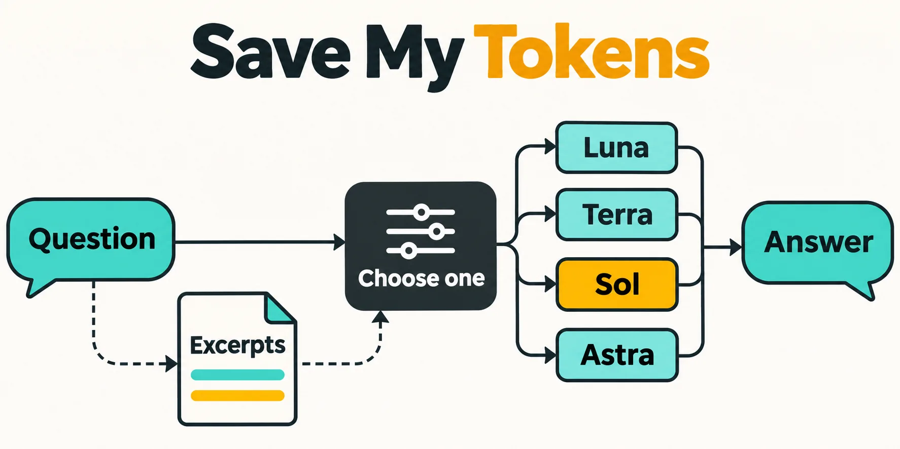
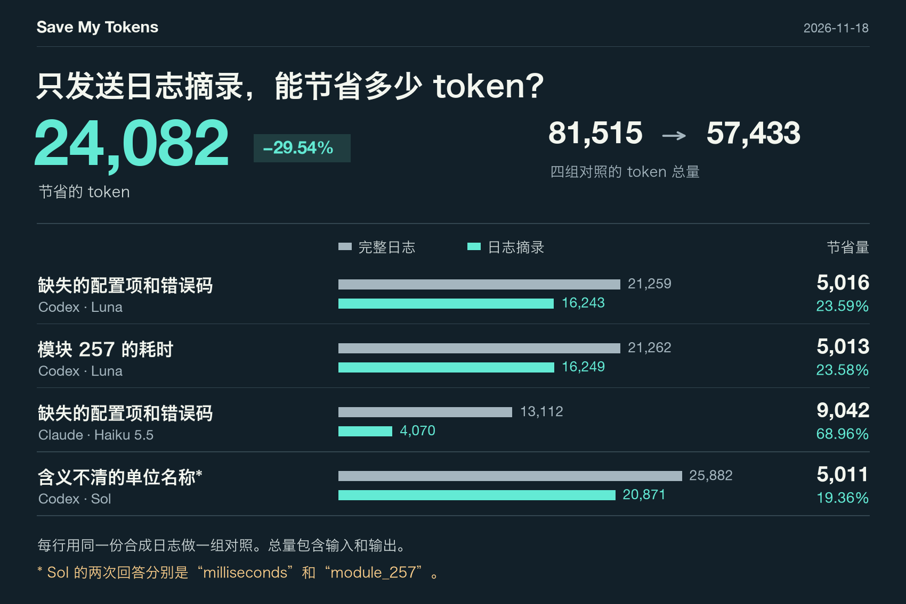

# Save My Tokens

[English](README.md) · [한국어](README.ko.md) · [简体中文](README.zh-CN.md) · [日本語](README.ja.md)

从长日志中找出回答问题所需的原文，并按任务选择模型。分类在本地完成，无需调用模型。



[查看四组对照如何节省 24,082 个 token](#实测结果)

## 工作原理

1. 按关键词搜索整个文件，保留匹配段落和字节位置。默认最多输出 4,096 字节。用 `--at BYTE` 查看附近的原文。统计全部出现次数时应搜索完整文件。
2. 本地规则把请求分为简单提取、范围明确的任务、常规实现和深入推理，并从所选平台的模型中进行选择。在终端对日志使用 `--ask`，会把问题和摘录发送给 Codex。
3. 图中以 Sol 回答问题为例。普通任务执行一次。只有主动发起对比，才会执行两次并记录两份答案。

## 按平台安装

先克隆仓库，在仓库目录中运行安装命令。将 `/path/to/project` 改为现有项目的路径，将 `cursor` 改为表中的安装 ID。每个项目技能都自带 Python 脚本。重新打开项目后选择 `save-my-tokens`。

```sh
git clone https://github.com/pappagallos/save-my-tokens.git
cd save-my-tokens
python3 install.py --platform cursor --project /path/to/project
```

若要安装 Codex 原生插件，在仓库目录运行以下命令，然后新建对话。安装后请保留仓库目录。

```sh
codex plugin marketplace add .
codex plugin add save-my-tokens@save-my-tokens-local
codex plugin list --marketplace save-my-tokens-local --json
```

需要 Python 3.9 或更高版本和 Git。运行模型前，先安装所选平台的 CLI。可在 PATH 中的个人目录创建链接，然后从工作项目启动。

```sh
mkdir -p "$HOME/.local/bin"
ln -s "$PWD/save-my-tokens" "$HOME/.local/bin/save-my-tokens"
```

| 平台 | 安装 ID | 项目目录 | 终端模型选择 |
|---|---|---|---|
| Codex CLI | `codex` | `.agents/skills/` | CLI 模型列表 · `codex` |
| Claude Code | `claude` | `.claude/skills/` | 服务商别名 · `claude` |
| Cursor | `cursor` | `.cursor/skills/` | CLI 模型列表 · `agent` |
| Gemini CLI | `gemini` | `.gemini/skills/` | ACP 模型列表 · `gemini --acp` |
| Grok Build | `grok` | `.grok/skills/` | CLI 模型列表 · `grok` |
| GitHub Copilot | `copilot` | `.github/skills/` | ACP 模型列表 · `copilot --acp` |
| Devin | `devin` | `.devin/skills/` | ACP 模型列表 · `devin acp` |
| OpenCode | `opencode` | `.opencode/skills/` | ACP 模型列表 · `opencode acp` |
| Google Antigravity | `antigravity` | `.agents/skills/` | ACP 模型列表 · `agy_acp_server.par` |
| Kiro | `kiro` | `.kiro/skills/` | ACP 模型列表 · `kiro-cli acp` |
| TRAE | `trae` | `.trae/skills/` | ACP 模型列表 · `traecli acp serve` |
| TRAE China | `trae-cn` | `.trae/skills/` | ACP 模型列表 · `traecli acp serve` |
| Qoder | `qoder` | `.qoder/skills/` | ACP 模型列表 · `qodercli --acp` |
| Mistral Vibe | `vibe` | `.vibe/skills/` | ACP 模型列表 · `vibe-acp` |
| Pi | `pi` | `.pi/skills/` | ACP 模型列表 · `pi-acp` |
| Hermes Agent | `hermes` | `.hermes/skills/` | ACP 模型列表 · `hermes acp` |
| DeepSeek Harness | `deepseek` | `.dsh/skills/` | ACP 模型列表 · `dsh --profile acp` |
| Oh My Pi | `omp` | `.omp/skills/` | ACP 模型列表 · `omp acp` |
| Replit Agent | `replit` | `.agents/skills/` | 手动选用外部引擎 |
| Rovo Dev | `rovodev` | `.rovodev/skills/` | 手动选用外部引擎 |
| Veto | `veto` | `.veto/skills/` | 手动选用外部引擎 |

ACP 是终端和编码助手之间的通信协议。终端通过它获取可用模型，并在发出问题前设置模型。请安装表中对应的程序并登录。项目技能也可以直接在编辑器中摘取原文。使用 Hermes 时，在项目内运行 `hermes skills trust`。安装后重启 Trae。若 Veto 只读取用户级技能，请使用 `--project "$HOME"`。

Claude 连续对话还需要 `claude-agent-acp`。ACP 程序必须公开可选模型。平台的工具权限继续生效。

上表描述通用技能及终端执行器。应用内会话的验证范围见下表。

## 在普通 Codex 对话中分配子任务

从同一插件市场安装下面的可选插件，在 Codex 的 **插件 → 已安装 → Save My Tokens · Auto Workers** 中启用。

```sh
codex plugin add save-my-tokens-auto@save-my-tokens-local
```

将下面这句话添加到个人 `~/.codex/AGENTS.md`，然后打开新对话。

> 如果当前提供 `save-my-tokens-auto:assign-worker` 技能，我明确要求在每次请求中将可独立完成的子任务委派给原生子代理。保留主模型并遵守项目规则。

主代理直接回答简单问题。需要分工时，摘录优先用 Luna，局部调查用 Terra，跨文件修改用 Sol，复杂设计分析用 Astra。只能从当前对话允许的子代理模型中选择。关闭插件后，新对话中将不再显示该技能。在 Codex CLI 0.169.0 的普通对话中，我们要求调查两条独立的代码路径。会话记录显示主模型为 Sol（`gpt-6.2-sol`），检查用量计算的子代理为 Terra（`gpt-6.1-terra`）。启动子代理也会消耗词元。下方的对比数据来自日志摘录实验。 [Codex](https://learn.chatgpt.com/docs/agent-configuration/subagents)

## 在其他应用的对话中自动分配任务

在克隆的仓库中运行安装命令并开启新对话。添加 `--auto-workers` 可启用下表中的集成方式。普通安装命令只安装通用技能。

```sh
python3 install.py --platform claude --project /path/to/project --auto-workers
```

需要模型 ID 时，安装程序会查询已登录的 CLI。也可以将下方的 LIGHT、STANDARD、DEEP 替换成该应用子代理可选的模型 ID。每个任务按角色分配。平台发布新模型后，再次运行安装程序以刷新固定的 ID。用户编辑过的文件会保留。如果只有一个可用模型，多个角色可以共用。

```sh
python3 install.py --platform cursor --project /path/to/project --auto-workers --worker-models LIGHT STANDARD DEEP
```

Grok 和 Devin 从个人文件读取这些设置。添加 `--user-settings` 可更新个人文件。Grok 会设置三个子代理的模型，Devin 会把默认模型改成 Adaptive。Replit 需要在应用的设置菜单中选择。

```sh
python3 install.py --platform grok --project /path/to/project --auto-workers --user-settings
python3 install.py --platform devin --project /path/to/project --auto-workers --user-settings
```

| 平台 | 应用内设置 | 本次验证范围 |
|---|---|---|
| Codex | 启用上述 Auto Workers 和个人指令。 [Codex](https://learn.chatgpt.com/docs/agent-configuration/subagents) | 真实主模型及子模型记录 |
| Claude Code | 项目规则引导主代理把取证、修改、复杂调查分别交给 Haiku、Sonnet、Opus。 [文档](https://code.claude.com/docs/en/sub-agents) | 实际自动调用 Haiku 和 Opus |
| Cursor | 安装三个角色和始终生效的项目规则。实际模型由套餐及团队策略决定。 [文档](https://cursor.com/docs/subagents) | 2026.11.17 要求登录，未确认角色加载 |
| Gemini CLI | 安装三个子代理并在 GEMINI.md 中追加项目指令。使用可选模型 ID。 [文档](https://geminicli.com/docs/core/subagents/) | 0.68.0 已向本地测试服务器发出子代理请求 |
| GitHub Copilot CLI | 安装三个可自动选择的角色并要求使用指定模型。验证时将主模型设为固定值。 [文档](https://docs.github.com/en/copilot/how-tos/copilot-cli/customize-copilot/create-custom-agents-for-cli) | 1.0.113 找到三个角色，账户策略阻止推理 |
| OpenCode | 安装三个子代理，使用 provider/model，可附加 #variant。 [文档](https://opencode.ai/docs/agents/) | 1.19.6 和 2.3.2 载入角色，2.3.2 在本地测试服务中完成委派 |
| Grok Build | 项目规则调用 explore、general-purpose、plan。加 --user-settings 可写入个人模型映射。 [文档](https://docs.x.ai/build/settings/reference) | 1.0.89 经授权完成两个子任务。该账户只提供 grok-4.7 |
| Devin CLI | 使用 /model adaptive 或通过 --user-settings 设置个人默认值。受企业策略约束。 [文档](https://docs.devin.ai/cli/adaptive) | 3000.14.30821 接受配置；模型列表要求登录 |
| Replit Agent | Free Mode 自动路由。在符合条件的套餐中可在 Power/Max 下选择 Auto。 [文档](https://docs.replit.com/features/agent/agent-modes) | 已核对设置步骤 |
| Antigravity | 安装 flash、inherit、pro 三个角色，可在 /agents 中确认。 [文档](https://antigravity.google/docs/subagents) | 已在临时项目安装 |
| Kiro | IDE 1.x 或 CLI V3，使用 /model 中的模型 ID。 [文档](https://kiro.dev/docs/custom-agents/configuration-reference/) | 已在临时项目安装 |
| Qoder | 在受信任项目中运行 /agents reload，默认档位为 lite、efficient、performance。 [文档](https://docs.qoder.com/cli/subagent) | 1.1.91 可启动，隔离环境中未返回角色列表 |
| Mistral Vibe | 提供已配置的模型别名，并打开受信任的项目。 [文档](https://docs.mistral.ai/vibe/code/cli/agents) | 3.1.2 载入三个别名，需查看回退提示 |
| TRAE China | 使用内置 Agent 和内置模型 ID。必要时在 Beta 中启用 Subagents Directory。 [文档](https://docs.trae.cn/ide_subagents) | 已在临时项目安装 |
| Rovo Dev | 安装三个角色后，在 /subagents 中分别选择模型。 [文档](https://support.atlassian.com/rovo/docs/use-subagents-in-rovo-dev-cli/) | 已在临时项目安装 |
| Oh My Pi | 安装三个 task 角色，指定 Oh My Pi 识别的模型。 [文档](https://github.com/can1357/oh-my-pi/blob/main/docs/task-agent-discovery.md) | 18.22.2 的 /agents 列出三个项目角色 |
| Pi | 需要 pi-subagents 扩展并信任项目。安装扩展和角色后运行 /subagents-doctor。 [文档](https://github.com/nicobailon/pi-subagents/blob/main/docs/agents.md) | 已在临时项目安装 |
| Hermes | 启用 advanced-delegation，用 hermes delegation config 设置路由，在 /delegation 中选择 model_map。 [文档](https://hermes-agent.nousresearch.com/docs/user-guide/features/delegation) | 已核对设置步骤 |
| DeepSeek Harness | 在 Plugins 中启用子代理模型选择，授权提供商与模型组合，然后开启新会话。 [文档](https://github.com/deepseek-ai/deepseek-harness/blob/master/packages/subagent/tool-subagent/README.md) | 已核对设置步骤 |
| TRAE Global | 在 .trae/agents 安装三个角色，使用内置 Agent 和模型 ID。 [TRAE](https://docs.trae.ai/ide/subagents) | 已在临时项目安装 |
| Veto | 用 veto doctor 检查集成，用 veto start 启动新的外部会话。 [文档](https://github.com/oleg-koval/veto) | 已核对设置步骤 |

**2026-11-18 验证。** 在已登录的新会话中，Codex 0.169.0 和 0.170.0 保留 Astra 作为主模型，并把一项调查交给 Terra；简单算术只调用主模型。Claude Code 2.1.319 由 Sonnet 分别调用 Haiku 和 Opus。受测 Codex 软件包为 Save My Tokens 0.4.0 和 Auto Workers 0.2.0。下方词元图来自日志摘录实验。每次调用子模型都会产生额外用量。

本地测试服务器用预设响应验证宿主的真实分派路径和模型 ID。临时项目安装只检查生成的配置。实际用量及节省情况需要在账户上另行实测。Grok 个人配置需 Python 3.11+ 或 tomli。

可运行以下命令复查安装。检查真实应用时，在新会话中提出两项独立调查，然后在子任务记录中核对角色和实际模型。

```sh
python3 -m unittest discover -s experiments -p 'test_*.py'
```

## 为每个请求选择模型

`route` 预览模型选择，`task` 执行一次请求，`chat` 保留同一会话并在每一轮重新选择模型。输入 `/exit` 退出。切换发生在启动器创建的会话中。已有编辑器对话的模型由编辑器管理。表中标记为外部引擎的平台需要在项目终端显式指定已登录的引擎，例如 `--engine codex`。

```sh
save-my-tokens route --engine codex '提取错误代码'
save-my-tokens task --engine claude '实现解析器'
save-my-tokens chat --engine codex
save-my-tokens build.log -q failure_code --ask '提取错误代码'
```

路由先选适合当前任务的模型系列，再选该系列在当前列表中版本号最高的模型。系列优先级由本项目的规则决定。账号、地区和 CLI 版本会影响列表。只有一个模型时，四个等级均使用它。Claude 单次执行使用服务商维护的 Haiku、Sonnet 和 Opus 别名。空列表会停止执行。可用 `--model ID` 指定模型，或用 `--tiers 轻量 聚焦 常规 深度` 自定义四个等级。简短的“继续”沿用上一等级。 [Codex](https://learn.chatgpt.com/docs/non-interactive-mode) · [Claude Code](https://code.claude.com/docs/en/model-config) · [Cursor](https://cursor.com/docs/cli/reference/parameters) · [Grok Build](https://docs.x.ai/build/cli/reference) · [Gemini](https://geminicli.com/docs/cli/model/) · [ACP](https://agentclientprotocol.com/protocol/v1/session-config-options) · [ACP registry](https://github.com/agentclientprotocol/registry)

下表是优先选择的模型系列。两个阶段可以使用同一模型。多服务商平台只选当前账号公开的模型。账号允许时可用 `--model fable` 显式选择 Claude Fable。预览别名显示的是传给服务商的名称，具体版本与计费条件由服务商决定。

| 任务 | 简单提取 | 范围明确的任务 | 常规实现 | 深入推理 |
| --- | --- | --- | --- | --- |
|  | 提取、翻译或简短摘要 | 检查截图或修改单个函数 | 实现功能、调试或重构 | 排查竞态、偶发数据丢失或跨服务故障 |
| Codex | Luna | Terra | Sol | Astra |
| Claude Code / Kiro | Haiku | Sonnet | Sonnet | Opus |
| Gemini / Antigravity | Flash-Lite | Flash | Flash | Pro |
| Cursor | Mini / Haiku | Composer / Terra | Sonnet / Sol | Opus / Astra |
| Grok Build | Non-reasoning / Fast | Build / Code | Build / Grok | Reasoning / Heavy / Grok |
| Copilot | Mini / Haiku | Terra / Flash | Sol / Sonnet | Astra / Opus |
| Devin | Haiku / Fast | SWE / Terra | Sonnet / Sol | Opus / Astra |
| Qoder | Efficient | Efficient | Performance / Fast | Ultimate |
| Mistral Vibe | Small / Mini | Devstral Small | Devstral / Medium | Large / Medium |
| DeepSeek Harness | Flash | Flash / Coder | Pro / Chat | Pro / Reasoner |
| TRAE / TRAE China | Flash / Mini | Coder / Seed | Sonnet / GLM / Qwen | Opus / Pro / Reasoner |
| OpenCode / Hermes / Pi / Oh My Pi | Luna / Haiku / Flash-Lite | Terra / Flash / Sonnet | Sol / Sonnet / Composer | Astra / Opus / Pro |

Replit 和 Rovo Dev 使用项目终端中明确指定的外部 CLI。Rovo 自带交互菜单 `/models`。对于 oleg-koval 的 Veto CLI，`task --host veto --engine codex` 会把所选模型传给 `veto start`。其他 Veto 产品可在终端直接选外部引擎。 [Devin](https://docs.devin.ai/cli/models) · [Copilot](https://docs.github.com/en/copilot/reference/ai-models/supported-models) · [OpenCode](https://opencode.ai/docs/models/) · [Qoder](https://docs.qoder.com/cli/model) · [DeepSeek](https://api-docs.deepseek.com/quick_start/pricing/) · [Mistral](https://docs.mistral.ai/models) · [Rovo](https://support.atlassian.com/rovo/docs/switch-between-large-language-models-in-rovo-dev-cli/) · [Veto](https://github.com/oleg-koval/veto)

```sh
save-my-tokens models --engine codex
save-my-tokens models --engine gemini
save-my-tokens models --engine qoder
save-my-tokens route --host replit --engine claude 'fix a typo'
```

## 逐题比较用量

用同一个文件和同一个问题执行 `compare`，会产生两次服务调用。有文件时默认使用相同模型，以比较摘录的效果。没有文件时，将常规模型与自动选择的模型进行比较。用 `--baseline-model` 更改基线。Codex 与 Claude Code 支持真实用量比较。所有平台都可使用 `measure` 在本地按 OpenAI 的 `o200k_base` 编码估算文本大小。

```sh
python3 experiments/benchmark.py --write-log /tmp/smt-example.log
question='Extract the missing key and failure code. Return both values.'
./save-my-tokens compare "$question" --file /tmp/smt-example.log -q failure_code \
  --expect SNAPSHOT_CLOCK --expect E7429 --out results.jsonl
./save-my-tokens compare --engine claude "$question" --file /tmp/smt-example.log -q failure_code
uv run --with tiktoken==0.12.0 -- ./save-my-tokens measure "$question" --file /tmp/smt-example.log -q failure_code
```

记录问题、两边的模型、输入、缓存输入、输出、总量、耗时、原始答案与预期文字是否出现。缓存输入已计入输入。节省量等于原始总量减去优化后总量，负数表示增加。`--out` 将问题和答案追加到指定本地文件。

## 实测结果



| 问题 | 模型 | 之前 → 之后（总量） | 降幅 | 答案 |
|---|---|---|---|---|
| 缺失的设置项与错误代码 | Luna | 21,259 → 16,243 | 23.59% | 均正确 |
| 模块 257 的耗时 | Luna | 21,262 → 16,249 | 23.58% | 均为 `15` |
| 缺失的设置项与错误代码 | Haiku 5.5 | 13,112 → 4,070 | 68.96% | 均正确 |
| 含义不清的单位名称问题 | Sol | 25,882 → 20,871 | 19.36% | 答案不同 |

各行均为同一份合成日志上的一组成对测试。对表述不清的问题，答案分别为 `milliseconds` 与 `module_257`。仅检查字符串无法判断哪一种解释符合提问者的本意。总量包含服务附加的提示。本实验没有测量订阅额度、费用或平均节省比例。换模型也会影响缓存复用。 [JSONL](experiments/observations.jsonl) · [v0.2.0 · 한국어](experiments/v0.2.ko.md)

## 研究与文档依据

Nature 上的 OpenScholar 研究评估了检索相关段落与标注来源的方法。npj Digital Medicine 的实验改变了证据在长文本中的位置。我们据此搜索整个文件，并保留原文偏移量。本工具使用字面匹配，日志上的效果由项目单独测量。 [Nature · OpenScholar](https://www.nature.com/articles/s41586-025-10072-4) · [npj Digital Medicine](https://www.nature.com/articles/s41746-025-01651-w) · [2025 JIF](https://www.nature.com/nature-portfolio/about-journals/journal-metrics)

Superpowers 先介绍工作流程与各客户端的安装方式。Context7 对比同一请求的结果。RTK 提供用量测量命令。Impeccable 在示例旁列出支持的平台。这里还公开了正确性检查和结果有分歧的案例。 [Superpowers](https://github.com/obra/superpowers) · [Context7](https://github.com/upstash/context7) · [RTK](https://github.com/rtk-ai/rtk) · [Impeccable](https://github.com/pbakaus/impeccable/tree/d41d9860b0094dcb68030657da63461212835aaa)

在本次找到且显示分数的 Codex 帖子中，一篇减少重复读取和冗长输出的经验帖为 +298 分，一篇将简单任务交给轻量模型的路由帖为 +21 分。11 月另有 Claude Code 的后续实验，比较不同任务的成本和正确性。分数是检索时的快照，结果取决于作者的工作负载。 [r/codex · +298](https://www.reddit.com/r/codex/comments/1tyxkzj/how_i_cut_codex_token_use_from_138mday_to_20mday/) · [r/codex · +21](https://www.reddit.com/r/codex/comments/1vdbi4s/luna_just_got_80_cheaper_so_i_rebuilt_my_codex/) · [r/ClaudeCode](https://www.reddit.com/r/ClaudeCode/comments/1xxyc5a/does_delegating_to_cheaper_models_actually_save/)
